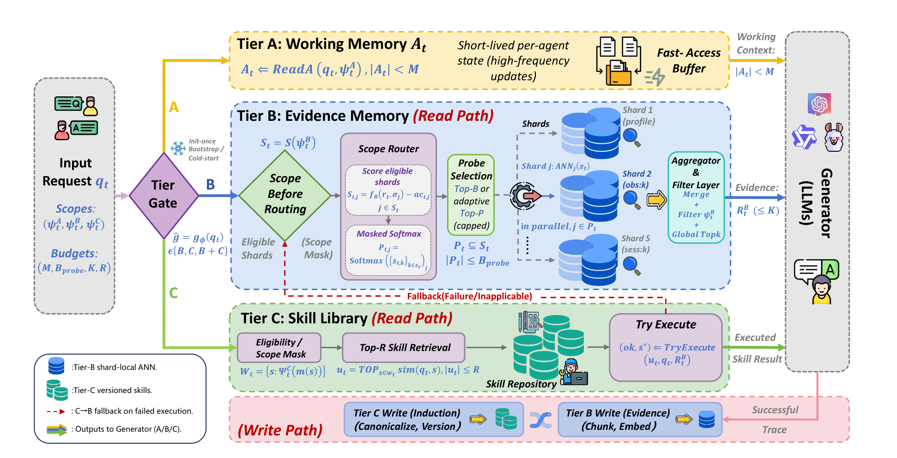

<div align="center">

<picture>
  <source media="(prefers-color-scheme: dark)" srcset="assets/logo-dark.svg">
  
</picture>

<p><strong>Scope-before-routing retrieval over sharded agentic memory</strong></p>

<p>
  <a href="https://arxiv.org/abs/2601.21545"></a>
  <a href="https://arxiv.org/abs/2601.21545"></a>
  <a href="LICENSE"></a>
  
  
</p>

<p>Yang Zhao<sup>*</sup>, Chengxiao Dai<sup>*</sup>, Mengying Kou, Yue Xiu, Dusit Niyato<br>
<sub><sup>*</sup>Equal contribution</sub></p>

<p><strong>English</strong> | <a href="README.zh-CN.md">简体中文</a></p>

</div>

## Overview

Official implementation of *ShardMemo: Scope-Before-Routing for Agentic Memory Retrieval* (Findings of EMNLP 2026). ShardMemo is a three-tier memory service for LLM agents: Tier A keeps a bounded active context, Tier B stores evidence in shards with shard-local approximate nearest neighbor indexes, and Tier C holds a versioned skill library. In Tier B, metadata predicates first decide which shards a request may access, and a learned masked router then probes a few of the admissible shards, so inadmissible shards never consume probe budget. Experiments cover LoCoMo, HotpotQA and ToolBench.

## Architecture

<p align="center">
  
</p>

## Setup

Python 3.11 or newer.

```bash
git clone https://github.com/Erikdai/shardmemo.git
cd shardmemo
pip install -r requirements.txt
cp .env.example .env    # fill in your LLM API
```

LoCoMo and the HotpotQA distractor dev set are downloaded to `data/raw/` on first use.

## Running

```bash
python experiments/run_locomo.py
python experiments/run_hotpotqa.py
python experiments/run_toolbench.py
```

| Script | What it runs |
| --- | --- |
| `run_locomo.py` | Per-category results, ablations, probe-budget sweep, shard-count scaling, label-noise robustness and adaptive Top-P sensitivity; select parts with `--groups stats main ablations sweep scaling noise sensitivity` |
| `run_hotpotqa.py` | Results at 56K, 224K and 448K context, one shard per document |
| `run_toolbench.py` | Tier C skill retrieval and ablations, family-level OOD with online induction, and a case study of direct execution and C to B fallback |

Every script accepts `--seeds`. Each run writes `results/<benchmark>/summary.json` and `results/<benchmark>/report.md`; embeddings and LLM responses are cached in `results/cache/`.

All settings are in `shardmemo/config.py` (`LocomoConfig`, `HotpotQAConfig`, `ToolBenchConfig`). Answers are generated by any LLM behind an OpenAI-compatible API, set by `LLM_API_KEY`, `LLM_BASE_URL` and `LLM_MODEL` in `.env`.

## Repository structure

```
.
├── assets/
│   ├── framework.png       Framework figure
│   ├── logo-light.svg      Logo, light theme
│   └── logo-dark.svg       Logo, dark theme
├── shardmemo/
│   ├── config.py           Budgets, router, training, ranking and index settings; configuration of each benchmark
│   ├── scope.py            Memory metadata, requests and scope predicates
│   ├── embedding.py        Sentence embedder with an on-disk cache
│   ├── index.py            Shard-local HNSW / flat index that counts scanned vectors
│   ├── ranking.py          BM25 and the fused evidence score
│   ├── memory.py           Evidence items, shards and shard-map construction
│   ├── router.py           Shard scorer, masked softmax, Top-B_probe and adaptive Top-P selection
│   ├── training.py         Routing losses and router training
│   ├── tier_a.py           Tier A active context
│   ├── tier_b.py           Tier B scope-before-routing retrieval
│   ├── tier_c.py           Tier C skill induction, versioning, retrieval and validated execution
│   ├── controller.py       Tier gate and the read path across the three tiers
│   ├── generator.py        Prompts and the OpenAI-compatible answer generator
│   ├── metrics.py          F1, BLEU-1, ShardHit and latency statistics
│   └── data/
│       ├── locomo.py       LoCoMo evidence, session anchors and requests
│       ├── hotpotqa.py     HotpotQA under the MemAgent long-context protocol
│       └── toolbench.py    ToolBench-style tool environment, traces and tasks
├── experiments/
│   ├── common.py           Routing supervision, evaluation and report helpers
│   ├── run_locomo.py       LoCoMo experiments
│   ├── run_hotpotqa.py     HotpotQA experiments
│   └── run_toolbench.py    ToolBench experiments
├── .env.example            LLM API settings template
└── requirements.txt        Pinned dependencies
```

## Citation

```bibtex
@misc{zhao2026shardmemoscopebeforeroutingagenticmemory,
      title={ShardMemo: Scope-Before-Routing for Agentic Memory Retrieval}, 
      author={Yang Zhao and Chengxiao Dai and Mengying Kou and Yue Xiu and Dusit Niyato},
      year={2026},
      eprint={2601.21545},
      archivePrefix={arXiv},
      primaryClass={cs.AI},
      url={https://arxiv.org/abs/2601.21545}, 
}
```

## License

[MIT](LICENSE)
